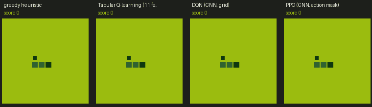
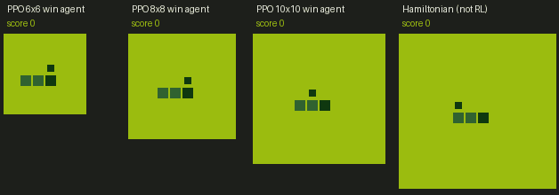
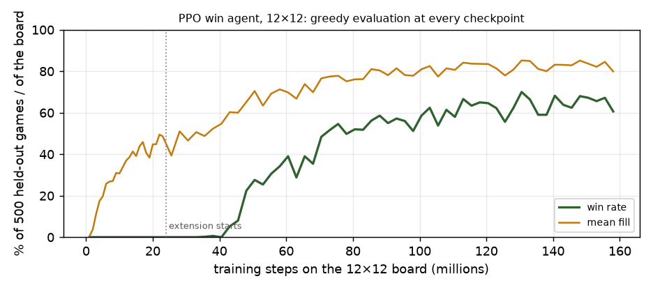

# Snake RL from scratch

**Reinforcement learning in Snake: implementations, experiments, and a browser demo.**
Tabular Q-learning → deep Q-networks and their upgrades → PPO → a "win the whole board" challenge. The course includes interactive notes, runnable code, trained agents, and multi-seed ablations where available.

> **Headline result.** Pure reinforcement learning (masked PPO with a reachable-area input channel, no planner) learns to **fill the whole board**
> on 6×6 (**97%** of games), 8×8 (**89%**), 10×10 (**63%**) and the standard 12×12 (**68%**, 340 of 500), trained on **one laptop GPU
> (GTX 1650 Ti, 4 GB)**, about **{{HOURS}} hours** of training in total for the whole course. Win rates are measured on 500 held-out games
> with the greedy policy; each win agent is a **single training run**, so read them as one measurement, not a mean over seeds.
> Every agent that optimised the score alone, on the same 12×12 board, never filled it.



*Above: the greedy heuristic and three learned agents on the standard 12×12 board. Below: the win-challenge agents filling 6×6, 8×8 and 10×10 boards (and, for contrast, the non-RL Hamiltonian-cycle agent on 12×12).*



**▶ Play and watch the agents:** open [`game/index.html`](game/index.html) (double-click it; it runs from disk with no server), or the hosted version at `https://kartik-a-1820.github.io/snake-rl-from-scratch/`.
**📖 Read the course:** the [notes index](#the-course) (interactive HTML, DOCX, and one master book).

## Implementation and evaluation

- **Cross-language environment checks.** The engine (rules, RNG, food placement) lives in `game/index.html` (JavaScript) and is mirrored in Python and as GPU tensors. Parity tests replay JavaScript traces in Python and the vectorised environment, checking matched behavior on the covered cases.
- **Evaluation protocol.** Every score is the *greedy* policy on **500 held-out seeds** that are never used for training or checkpoint selection (checkpoints are chosen on 200 separate validation seeds). Comparisons use several training seeds and report mean ± sample standard deviation. A result from a single seed is labelled as one.
- **Negative results are results.** Several things in this repository did *not* work, and the notes say so with the numbers (see [Findings](#findings)).
- **Result tables are generated** from repository records by `tools/make_readme.py`; the surrounding prose interprets those measurements.
- **Small-GPU engineering:** GPU-batched environments, a measured study of how many jobs can share one GPU, pause/resume for long runs.

## The course

One tryout per chapter: concepts, then the interactive note, a downloadable DOCX, and the key result.

| # | Concepts | Read | Key result |
|---|---|---|---|
| 01 | Tabular Q-learning: MDPs, Bellman backups, ε-greedy, why 11 hand-made features hit a ceiling | [note](notes/01_tabular_q_learning.html) · [docx](notes/01_tabular_q_learning.docx) | mean ≈ 20 on 12×12 (a ceiling) |
| 02 | Deep Q-networks: function approximation, replay, target networks, Double DQN, GPU-batched environments; a failed run and its diagnosis | [note](notes/02_dqn.html) · [docx](notes/02_dqn.docx) | CNN DQN, best checkpoint 24.5 |
| 03 | Upgrading DQN: dueling, prioritized replay, action masking, a multi-seed ablation | [note](notes/03_dqn_upgrades.html) · [docx](notes/03_dqn_upgrades.docx) | most upgrades did *not* help here (untuned) |
| 04 | Policy gradients and PPO: REINFORCE, baselines, GAE, clipping, on- vs off-policy, throughput on a small GPU | [note](notes/04_ppo.html) · [docx](notes/04_ppo.docx) | masked PPO: the best learned 12×12 agent |
| 05 | The win challenge: curriculum learning, sparse rewards, long horizons, and a planner that never loses | [note](notes/05_win_challenge.html) · [docx](notes/05_win_challenge.docx) | PPO fills 6×6, 8×8, 10×10 and 12×12 boards (97 / 89 / 63 / 68%) |

The whole course as one book: [`notes/snake_rl_master.docx`](notes/snake_rl_master.docx).

## Results

All agents below are in the game's **Agent** dropdown (grouped by family, with an info card, learning curve, and a Compare mode). "Fill" is the mean score as a share of the foods that fit on the board (cells − 3), which lets agents on different boards be compared.

{{LEADERBOARD}}

*Per-game sd* is the spread of the 500 test games, not across training runs. Where several training seeds exist, the "across training seeds" column gives mean ± sample sd, with the scope stated. Best-checkpoint numbers are the maximum over about 20 noisy evaluations and are optimistic; the last-checkpoint spread is discussed in the notes.

### Ablations, 3 training seeds each

**Tryout 03: upgrades to the DQN (1 M steps each, CNN on the board image).**

{{ABLATION03}}

**Tryout 04: PPO with and without action masking (10 M steps each).**

{{PPOARMS}}

### The win challenge: filling the whole board

A *win* means every cell is filled. Win rates are over 500 held-out seeds; "mean fill" is the average share of the board filled. The Hamiltonian-cycle agent is **not reinforcement learning**: it follows a fixed route through every cell, uses full knowledge of the rules, and shows what winning looks like.

{{WINS}}

**The 12×12 trajectory.** The 24 M-step run won nothing; the extension (same recipe, more parallel environments) won its first game after about 12 M further steps, climbed steadily to about 50 M, and then moved between 55% and 70% until the plateau rule stopped it at 135 M further steps (158 M in total). The published agent is the checkpoint with the best *validation* score (340/500); the best single test evaluation was 350/500. Full table: [`docs/12x12_trajectory.md`](docs/12x12_trajectory.md).



{{TRAJECTORY}}

## Findings

The experiments below examine training schedules, architecture changes, reward design, and hardware limits. Their evidence includes multi-seed comparisons and explicitly labeled single-run observations.

1. **A DQN that "doesn't learn" can be a schedule bug, not an algorithm problem.** The first CNN run scored below 1 (the tabular agent scores 20): only about 7 600 gradient steps and 7 target-network syncs in 1 M environment steps. Changing the replay ratio (more updates per environment step, smaller batches, more frequent syncs) and adding 3-step returns took the same network to **16.5 ± 2.0** (3 seeds). An 11-feature MLP with the original schedule had already reached 20.9, which is what pointed at the schedule. ([note 02](notes/02_dqn.html))
2. **Reward shaping hurt.** Potential-based shaping (the theoretically safe kind, with a proof sketch and a test of the telescoping identity), naive "closer is good" shaping and a timeout penalty all scored below the unshaped baseline at 1 M steps; across 3 seeds potential shaping gave 11.7 against 16.5. Shaping preserves the optimal policy, it does not promise faster learning. ([note 02, §8b](notes/02_dqn.html))
3. **Dueling, prioritized replay and masking did not improve the DQN here.** Three seeds each: dueling 11.8 ± 1.1, dueling + PER 7.5 ± 0.4, masking alone 14.5 ± 0.7, all combined 12.1 ± 1.2, against 16.5 ± 2.0 for the plain recipe. These are untuned defaults and one network, so this says "did not transfer automatically", not "do not work". At 5 M steps the combination also lost (19.4 against 24.5, one seed). ([note 03](notes/03_dqn_upgrades.html))
4. **Action masking made PPO reliable, and seed variance is large.** Masked PPO scores **26.2 ± 0.4** over three seeds (26.5, 26.3, 25.7); the unmasked arm scored 21.4, 18.7 and 7.9 (16.0 ± 7.1) because some seeds learn to circle until the starvation limit. One lucky unmasked seed would have looked as good as masking. Masked PPO is the best learned agent on the standard 12×12 board by score, and it processes about 8× more environment steps per second than the DQN on the same GPU (about 7 000 against 900), though the DQN is the more sample-efficient of the two. ([note 04](notes/04_ppo.html))
5. **Winning is a different problem from scoring, and long training unlocks the big boards.** No agent that optimised the score ever filled a 12×12 board. A masked PPO agent with a reachable-area input channel fills a **6×6 board in 97% of games and 8×8 in 89%**, and 10×10 in **63%** after a long continued run. The 24 M-step 12×12 run won nothing (best game 120 of 141 cells); continuing it with more parallel environments produced the first 12×12 win after about 12 M further steps, and **68% of games (340 of 500) at the end of the extended run, 135 M further steps** (a single run that plateaued at 55–70%; see the trajectory above). A Hamiltonian-cycle agent, which uses the rules and learns nothing, wins every game at every size. ([note 05](notes/05_win_challenge.html))
   - **The reachable-area channel helped most early.** On 6×6, the two agents differ only in that extra input plane (every agent sees the tail order): 92% against 43% wins at 2 M steps and 94% against 83% at 4 M. The channel gives the network what a planner would compute, so it is information, not a rule; the final 6×6 agent (97%) trained 6 M steps.
   - **Curriculum transfer did not help on 8×8 in this run.** The agent initialised from the 6×6 weights won 4 of 500 games at its selected checkpoint, against 443 for the same recipe from scratch (one seed per variant, so an observation, not a verdict on curricula). With a flood-fill "trap shield" the curriculum run reached 248 wins, still below scratch; the shield is planning inside the agent, so the game labels it as not pure RL.
6. **The bottleneck on a small GPU is not memory.** One job needs about 440 MB of a 4 GB card, but two DQN jobs or one PPO job saturate its compute. Profiling a PPO job showed it launch-bound (environment stepping is more than half of each iteration; GPU 44% busy), and the one lever that helped a lot was **more parallel environments** (256 → 2 048: +124% steps/s), whereas fp16 autocast and `channels_last` were slower on this chip. ([note 04, §8](notes/04_ppo.html))
7. **Be careful what you call "best".** The best-checkpoint numbers are the maximum over about 20 noisy evaluations; the last-eight-checkpoint average of the 5 M-step DQN was 21.1 (range 16.9–24.9) against a reported best of 24.5. Everything here selects checkpoints on separate validation games, and reports seeds where there are several.

**Limits.** Most agents have a single training seed outside the ablation tables; hyperparameters are largely untuned (the DQN upgrades in particular); the win-challenge stages are single-seed runs, so differences between them are suggestive; and the 12×12 result comes from one extended run.

## Hardware and throughput

Everything ran on a laptop with an **NVIDIA GTX 1650 Ti (4 GB)**, an AMD Ryzen 7 4800H, torch 2.14 with CUDA 13.0. One training job needs only about **440 MB of GPU memory**, yet running more jobs in parallel stops helping early, because the GPU's compute and the CPU threads that feed it saturate long before the memory does. Measured with `python/bench_parallel.py` (identical jobs run together, other training paused):

{{THROUGHPUT}}

A PPO job (large GPU batches) saturates the GPU alone, so extra PPO jobs only split its throughput; a DQN job is launch-bound (48% GPU alone) so two jobs give 1.7×, and a third adds nothing. `python/jobq.py` uses these measurements: it starts a job only when memory, CPU and GPU utilisation leave headroom.

## Quickstart

For the browser demo, no Python environment or model download is needed: open `game/index.html`.

For CPU environment tests, use Python 3.11 in a separate environment:

```bash
git clone https://github.com/Kartik-A-1820/snake-rl-from-scratch.git
cd snake-rl-from-scratch
python -m venv .venv
```

Activate with `source .venv/bin/activate` on Linux/macOS or `.venv\Scripts\Activate.ps1` in Windows PowerShell:

```bash
python -m pip install torch --index-url https://download.pytorch.org/whl/cpu
python -m pip install -r requirements.txt
python -m pytest python/tests/test_env.py -q
```

For JavaScript/Python parity checks, install Node.js, generate reference traces with `node tools/make_trace.js python/tests/js_traces.json`, and run `python -m pytest python/tests -q`. CPU tests do not reproduce GPU training speed or the published model results.

For GPU training on Windows, use a separate compatible PyTorch environment and read [setup_cuda_windows.md](setup_cuda_windows.md). The convenience script's setup can install a CUDA wheel and creates a venv with system site packages; inspect it before running:

Windows / PowerShell:

```powershell
git clone https://github.com/Kartik-A-1820/snake-rl-from-scratch.git
cd snake-rl-from-scratch
powershell -ExecutionPolicy Bypass -File .\run.ps1 check    # what is installed (writes ENVIRONMENT.md), installs nothing
powershell -ExecutionPolicy Bypass -File .\run.ps1 setup    # venv + the right PyTorch wheel (CUDA when a GPU is found) + dependencies
powershell -ExecutionPolicy Bypass -File .\run.ps1 test     # parity tests: JavaScript = Python = GPU environment
powershell -ExecutionPolicy Bypass -File .\run.ps1 train01py   # tryout 01
powershell -ExecutionPolicy Bypass -File .\run.ps1 train02 --total-steps 1000000   # tryout 02 smoke run (about 20 minutes)
python python/train_ppo.py --mask --total-steps 10000000 --name my_ppo --publish 04_ppo --publish-name "My PPO" --tryout 4   # tryout 04
python python/train_ppo.py --size 6 --obs win6 --mask --gamma 0.995 --win-reward 10 --total-steps 6000000 --name my_6x6   # tryout 05, first stage
powershell -ExecutionPolicy Bypass -File .\run.ps1 notes    # rebuild the notes (the .docx files need pandoc)
```

To watch the trained agents, open `game/index.html`, pick an agent under **Pretrained agents**, or press **B** for the best one. To use your own model, drop its `best.json` on the **Custom model** panel.

Long runs can be paused safely: create `results/STOP` and each job saves its full state and exits; rerun it with `--resume` (see `python/snake_rl/resume.py`).

## Repository map

```
game/index.html            the game (single file): play, watch agents, compare, benchmark, replays. Works from file://
index.html                 landing page for GitHub Pages
notes/                     the course notes (HTML + DOCX) and their sources in notes/tryouts/NN_name/
models/<algo>/             one folder per agent: best.json, best.onnx, best.pt, meta.json, best.weights.js
models/registry.js         list of agents the game reads (generated)
python/snake_rl/           engine mirror, vectorised GPU environment, networks, registry/export, Hamiltonian agent
python/train_*.py          trainers (tabular, DQN, PPO), exporters, benchmarks, the job queue (jobq.py)
python/tests/              parity and environment tests
tools/                     Node tools (trace generator, model checker), README/GIF generators
results/                   per-run summaries and benchmark data behind every table
```

## Reproducibility notes

- **Hardware:** all numbers come from one GTX 1650 Ti laptop (4 GB), Windows 11, torch 2.14, CUDA 13.0. Other hardware and software environments require fresh validation of learning behavior and throughput. CPU training can be substantially slower.
- **Seeds:** training seeds are explicit (`--seed`); evaluation uses fixed seed ranges (test 100000–100499, validation 200000–200199), so any agent can be re-evaluated on exactly the same games.
- **Determinism:** GPU training is not bit-for-bit reproducible, so re-running a seed gives a nearby, not identical, result (this is why the ablations use three seeds). Parity tests check matched behavior of the game engine, Python mirror, and tensor environment on their covered traces.
- **Cost:** the whole course is about {{HOURS}} hours of training in total on that laptop (summed per-run time; some runs shared the GPU). The 12×12 extension alone ran about 135 M steps.
- **Long runs:** every PPO run saves resumable state each logging epoch (`--resume`); `tools/ext_supervisor.py` restarts it after a crash and logs GPU temperature (peak 66 °C during the extended run, no hardware throttling).

## Reproducing and extending

- Tests: `run.ps1 test` (JavaScript traces → Python and vectorised-environment parity, Gymnasium API checks) and `node tools/check_model.js` (exported networks: JavaScript inference equals PyTorch).
- New agents are published into the game with `python/export_model.py --ckpt X_best.pt --algo <id> --name "..."` (or `--publish` on the trainers); the registry and the game's dropdown update themselves.
- See [CONTRIBUTING.md](CONTRIBUTING.md).

## Licence and citation

Code, the game and trained model files: **MIT** ([LICENSE](LICENSE)). Notes, documentation and this README's text: **CC BY 4.0** ([LICENSE-docs](LICENSE-docs)).
Please cite via [CITATION.cff](CITATION.cff) (GitHub's "Cite this repository" button), or:

```bibtex
@software{snake_rl_from_scratch,
  title  = {Snake RL from scratch: reinforcement-learning theory, hands-on code and a browser demo},
  author = {Anagawadi, Kartik},
  year   = {2026},
  url    = {https://github.com/Kartik-A-1820/snake-rl-from-scratch}
}
```

## References

- Sutton & Barto (2018). *Reinforcement Learning: An Introduction*, 2nd ed.
- Mnih et al. (2015). Human-level control through deep reinforcement learning. *Nature*.
- van Hasselt, Guez & Silver (2016). Deep RL with double Q-learning. *AAAI*.
- Wang et al. (2016). Dueling network architectures for deep RL. *ICML*.
- Schaul et al. (2016). Prioritized experience replay. *ICLR*.
- Ng, Harada & Russell (1999). Policy invariance under reward transformations. *ICML*.
- Schulman et al. (2016). Generalized advantage estimation. *ICLR*. Schulman et al. (2017). Proximal policy optimization. *arXiv:1707.06347*.
- Huang & Ontañón (2020). A closer look at invalid action masking in policy gradient algorithms. *arXiv:2006.14171*.
- Bengio et al. (2009). Curriculum learning. *ICML*. Narvekar et al. (2020). Curriculum learning for RL domains. *JMLR*.
- Pardo et al. (2018). Time limits in reinforcement learning. *ICML*.
- Agarwal et al. (2021). Deep reinforcement learning at the edge of the statistical precipice. *NeurIPS*.
